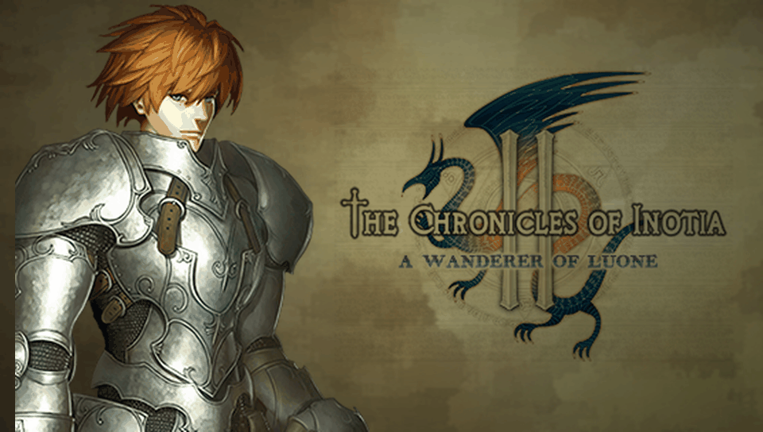

<h1 align="center">
  <br>
  Inotia 2: A Wanderer of Luone · PS Vita Port
</h1>

<p align="center">
  <a href="#-status--playability">Status & Playability</a> •
  <a href="#setup-instructions-for-players">How to install</a> •
  <a href="#controls">Controls</a> •
  <a href="#known-issues">Known Issues</a> •
  <a href="#build-instructions-for-developers">How to compile</a> •
  <a href="#credits--acknowledgments">Credits</a>
</p>

An unofficial, native **iOS-to-PS Vita wrapper port** of *The Chronicles of Inotia 2: A Wanderer of Luone* (originally developed by Com2uS). Unlike the Android ports, there is no ELF here: this port ships its own **Mach-O loader** that maps the official iOS ARMv6 executable (`Inotia2`, from the 1.1.41 IPA) into PS Vita RAM and replaces the Apple frameworks it uses (Foundation, UIKit, CoreGraphics, CoreAudio, OpenGL ES) with native implementations on top of **vitaGL**, **FreeType** and the Vita system libraries.

---

## 🎮 Status & Playability

**Status: PLAYABLE**

The game boots, loads assets, navigates menus, creates/loads character slots, and is fully playable on physical PlayStation Vita hardware.

- [x] **Mach-O loader**: loads the iOS ARMv6 executable, applies relocations (including safety fallbacks for symbol/data pointers), resolves ~400 Darwin/Apple imports (bridging 4-byte stack alignment and unaligned variadic arguments), runs C++ static initializers (FMOD), and enters the main game loop. *Verified on console.*
- [x] **Graphics**: GLES 1.1 → vitaGL. The game renders into a 320×480 framebuffer, rotated and stretched to full screen (960×544) on present with hardware acceleration. Apple CgBI PNG textures are decoded natively without file conversion. *Verified on console.*
- [x] **Touch & Controls**: Front touchscreen provides full touch input. All physical controls (D-Pad, Left Stick, face buttons, L/R, Start/Select) are mapped and verified working on console. *Verified on console.*
- [x] **Text & Fonts**: UIKit text rendering is backed by FreeType with PS Vita system fonts (Latin, Korean, Japanese), plus system keyboard integration. *Verified on console.*
- [x] **Audio**: FMOD Ex runs natively (BGM and sound effects in menus and in-game) with CoreAudio redirected to `sceAudioOut`. FMOD's VFPv2 vector-mode mixers, unsupported on the Cortex-A9, are replaced with scalar versions. *Verified on console.*
- [x] **Settings & saves**: game options (control type, auto-save, volume) and save games persist between sessions. *Verified on console.*
- [ ] **Videos**: `prologue.mp4` / `epilogue.mp4` are currently skipped.
- [x] **Offline bypasses**: App Store, "More Games", network, browser links, and anti-piracy checks are gracefully bypassed.

---

## Disclaimer

**The Chronicles of Inotia 2: A Wanderer of Luone** is a registered trademark of **Com2uS**. The work presented in this repository is unofficial and is not produced, endorsed, or sanctioned by Com2uS or any affiliated entities.

This software does NOT contain original game code, binaries, copyrighted graphics, or game assets. The authors do not promote or condone piracy in any way. To play, you must provide your own legally obtained, **decrypted** copy of the iOS `.ipa`.

---

## Setup Instructions (For Players)

1. **CFW & Plugins**: PS Vita on Custom Firmware (**Enso 3.60 / 3.65** recommended) with `kubridge` under `*KERNEL` in `ur0:tai/config.txt`:
   ```ini
   *KERNEL
   ur0:tai/kubridge.skprx
   ```
2. **Shader Compiler**: `libshacccg.suprx` must be in `ur0:data/` (extract it with **ShaRKBR33D**).
3. **Game Files**: a decrypted **Inotia 2 1.1.41** iOS `.ipa` (FairPlay `cryptid 0`). Open it as a ZIP and extract `Payload/Inotia2.app/`.
4. **Copy to the Vita** (`ux0:data/inotia2/`):
   ```
   ux0:data/inotia2/
     Inotia2.app/   the whole Inotia2.app folder from the IPA, untouched
     rebase.bin     generated from the executable (see "Build Instructions")
     saves/         created automatically — your save games
     logs/          created automatically — log_001.log … log_999.log, one per run
   ```
5. **Install VPK**: install `inotia2.vpk` with VitaShell.

---

## Controls

| Input | Action | Status |
| :---: | :--- | :---: |
| **Front Touchscreen** | Full touch UI, virtual joystick, menu selection, combat | ✅ Working |
| **D-Pad / Left Stick** | Character movement & menu navigation | ✅ Working |
| **Cross (✖)** | Attack / Action / Confirm / Interact | ✅ Working |
| **Square (◼)** | Skill 1 (Primary / Lower active skill) | ✅ Working |
| **Triangle (▲)** | Skill 2 (Middle active skill) | ✅ Working |
| **Circle (●)** | Skill 3 (Upper active skill) | ✅ Working |
| **L Trigger** | Potion / Quick Item slot | ✅ Working |
| **R Trigger** | Skill Wheel Switch / Special | ✅ Working |
| **Start** | Inventory / Status Menu | ✅ Working |
| **Select** | Minimap / World Map | ✅ Working |

> [!TIP]
> The original game was designed for full touch input. All UI buttons and virtual controls on the screen can be touched directly at any time.

---

## Known Issues

- **Videos skipped**: intro and ending cutscene movies are currently skipped.
- **Online features disabled**: App Store in-app purchases, Com2uS "More Games" and online leaderboards/network play are disabled by design.
- **Crash dumps** are written by the system to `ux0:data/` (not to the game folder).

---

## Build Instructions (For Developers)

### Prerequisites

- [VitaSDK](https://vitasdk.org/) (`$VITASDK`) with `vitaGL`, `vitashark`, `freetype`, `libpng` and `zlib`.
- CMake 3.14+, Python 3 (for the tools).
- The decrypted `Inotia2.app` folder, linked as `game_app` in the repo root (never committed).

### Compilation Commands

```bash
git clone https://github.com/your-username/Inotia2-vita.git
cd Inotia2-vita
ln -s /path/to/Payload/Inotia2.app game_app

# Stage the console data (copies the .app untouched + generates rebase.bin)
tools/stage_data.sh

# Build eboot.bin / inotia2.vpk
cmake -S . -B build -DCMAKE_BUILD_TYPE=Debug
cmake --build build
```

### Deploy & Debug (over VitaShell FTP)

```bash
python3 -I tools/deploy_data.py          # incremental upload of ux0_data/inotia2/ (never touches saves/)
python3 -I tools/deploy_data.py --logs   # fetch logs/log_NNN.log and crash dumps into ./logs/
```

A crash PC in `0x98xxxxxx` minus `0x98000000` is the address in the Mach-O: inspect it with `tools/annotate.py game_app/Inotia2 <symbol>`. Architecture and progress notes: [`PORTING_PLAN.md`](PORTING_PLAN.md).

---

## Credits & Acknowledgments

- **The Chronicles of Inotia 2: A Wanderer of Luone** is intellectual property of **Com2uS**.
- **Inotia 3 PS Vita Port** by [MetalSyntax](https://github.com/MetalSyntax/Inotia3-vita) for engine research and architectural insights.
- **vitaGL** graphics library by [Rinnegatamante](https://github.com/Rinnegatamante/vitaGL).
- **kubridge** plugin by [Bythos](https://github.com/bythos14/kubridge).
- **FreeType**, **libpng** and **zlib** projects.
- Special thanks to the PS Vita homebrew and porting community.
